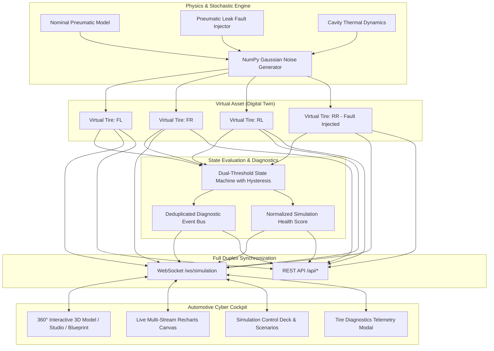

# TPMS Digital Twin — Software-Defined Vehicle Tire Monitoring System

> **Real-Time Tire Pressure Simulation & Predictive Monitoring for Software-Defined Vehicles (SDV)**

[](#)
[](#)
[](#)
[](#)

---

## 1. Project Overview

The **TPMS Digital Twin** is a modern, pure software-based digital replica of an automotive **Tire Pressure Monitoring System (TPMS)** designed for modern **Software-Defined Vehicles (SDV)**. 

In automotive engineering, a direct TPMS uses piezoresistive/capacitive micro-electromechanical sensors (MEMS) embedded in each tire valve assembly to broadcast wireless RF telemetry (315 MHz / 433 MHz) to the Central Gateway ECU.

This project delivers a **full-stack, production-quality cyber-cockpit simulation** that models four independent virtual tire pressure streams, simulates authentic Gaussian sensor jitter, models cavity thermodynamics, injects controllable slow and rapid pneumatic leaks, evaluates safety thresholds with physical hysteresis, and visualizes live telemetry through a futuristic automotive executive sedan dashboard.

**Zero hardware is required.** The entire simulation runs locally on any macOS, Linux, or Windows workstation.

---

## 2. Digital Twin Concept

A **Digital Twin** is not merely a static UI dashboard—it is an active, synchronized digital counterpart of a physical asset:



The system establishes:
1. **Virtual Representation**: High-fidelity virtual objects representing Front Left (FL), Front Right (FR), Rear Left (RL), and Rear Right (RR).
2. **Real-Time Data Generation**: Dynamic telemetry streamed at 2.0 Hz (500 ms intervals).
3. **State Synchronization**: Bi-directional WebSocket pipeline streaming snapshots to the cockpit in under 5 ms.
4. **Fault Injection**: Controlled pneumatic orifice leak modeling on any selectable wheel.
5. **Predictive Monitoring & Safety Alerts**: Automated threshold violations, thermal deflection tracking, and health metrics.

---

## 3. Mathematical Model

### 3.1 Healthy Tire Telemetry
Measured tire pressure is never a sterile, flat line. In real physical transducers, electrical resistance and road vibration introduce stochastic variance:

$$P(t) = P_{\text{nominal}} + \mathcal{N}(0, \sigma^2)$$

Where:
* $P_{\text{nominal}} = 34.0\text{ PSI}$ (cold baseline pressure)
* $\mathcal{N}(0, \sigma^2)$ is Gaussian random noise generated via `numpy.random.default_rng` with $\sigma \approx 0.09\text{ PSI}$.

### 3.2 Injected Pneumatic Leak Dynamics
When a puncture or valve leak is injected:

$$P_{\text{leak}}(t) = \max\left(0.0,\; P_{\text{nominal}} - \left(r \cdot \frac{t_{\text{simulated}}}{60}\right) + \mathcal{N}(0, \sigma^2)\right)$$

Where:
* $r$ is the configurable leak rate in $\text{PSI}/\text{minute}$ (default $0.05\text{ PSI/min}$ for slow leak, $0.35\text{ PSI/min}$ for rapid leak).
* $t_{\text{simulated}} = t_{\text{real}} \times \text{time\_multiplier}$ allows presentation acceleration ($1\times, 2\times, 5\times, 10\times, 20\times$).

### 3.3 Thermal Deflection Heating
Underinflated tires undergo increased sidewall flex, creating mechanical friction and thermal rise:

$$T_{\text{cavity}} = T_{\text{ambient}} + 4.0 + \left(\frac{v_{\text{kmh}}}{100} \times 3.5\right) + \max(0, (P_{\text{nominal}} - P_{\text{base}}) \times 0.35) + \mathcal{N}(0, 0.05^2)$$

### 3.4 Threshold Evaluation with Hysteresis
To prevent sensor noise from causing rapid flickering (chatter) between `NORMAL` and `WARNING`:
* **Nominal:** $34.0\text{ PSI}$
* **Warning Threshold:** $90\% \times 34.0 = 30.6\text{ PSI}$
* **Critical Threshold:** $80\% \times 34.0 = 27.2\text{ PSI}$
* **Hysteresis Band:** $\Delta = 0.25\text{ PSI}$

$$\text{Transition Rule: } \text{NORMAL} \to \text{WARNING if } P < 30.6\text{ PSI}$$
$$\text{Return Rule: } \text{WARNING} \to \text{NORMAL if } P \ge (30.6 + 0.25)\text{ PSI}$$

---

## 4. Technology Stack

### Backend
* **Python 3.11+**
* **FastAPI**: Asynchronous REST framework and WebSocket server.
* **Uvicorn**: High-concurrency ASGI server.
* **NumPy**: Stochastic Gaussian distribution generator (`np.random.default_rng`).
* **Pydantic v2**: Strict validation for all simulation models and telemetry snapshots.

### Frontend
* **React 19** & **Vite 8**: Ultra-fast hot-reloading frontend.
* **Tailwind CSS v4**: Futuristic dark cyber-automotive design system.
* **Recharts**: High-performance multi-stream live telemetry charts with reference lines.
* **Lucide React**: Crisp vector automotive iconography.
* **Web Audio API**: Synthesized cockpit alert tone on critical pressure loss.

---

## 5. Project Directory Structure

```text
TPMS/
├── backend/
│   ├── app/
│   │   ├── main.py                  # FastAPI application & lifecycle runner
│   │   ├── config.py                # Pydantic SimulationSettings & defaults
│   │   ├── simulation/
│   │   │   ├── engine.py            # SimulationEngine, loop, broadcast queues
│   │   │   ├── tire_model.py        # VirtualTire state machine & hysteresis
│   │   │   ├── noise.py             # NumPy Gaussian sensor noise generator
│   │   │   └── leak.py              # Pneumatic leak physics model
│   │   ├── models/
│   │   │   ├── tire.py              # TireState & Sensor telemetry schema
│   │   │   └── simulation.py        # SimulationSnapshot, Alerts, Status
│   │   └── api/
│   │       ├── routes.py            # REST endpoints (/api/status, /api/simulation, etc.)
│   │       └── websocket.py         # Full-duplex WebSocket (/ws/simulation)
├── frontend/
│   ├── public/
│   │   └── vehicle_studio.jpg       # Futuristic sedan in cyber garage
│   ├── src/
│   │   ├── components/
│   │   │   ├── AlertsPanel.jsx      # Diagnostic alerts list with audio chime
│   │   │   ├── SystemStatusPanel.jsx# Overall health & Digital Twin status
│   │   │   └── TireDetailsModal.jsx # Detailed tire telemetry & fault toggle
│   │   ├── layouts/
│   │   │   ├── Header.jsx           # Cockpit header, speed, temp, Demo trigger
│   │   │   └── Sidebar.jsx          # Navigation & Digital Twin status card
│   │   ├── pages/
│   │   │   ├── OverviewPage.jsx     # Main vehicle cockpit view
│   │   │   ├── TpmsPage.jsx         # 4-wheel telemetry matrix & diagnostics
│   │   │   ├── VehiclePage.jsx      # SDV architecture & gateway telemetry
│   │   │   ├── SimulationPage.jsx   # Mathematical formulas & simulation lab
│   │   │   └── SettingsPage.jsx     # Parameter tuning & theme preferences
│   │   ├── charts/
│   │   │   └── LivePressureChart.jsx# Real-time multi-stream Recharts canvas
│   │   ├── vehicle/
│   │   │   ├── VehicleView.jsx      # 3D Cyber Studio & Blueprint SVG views
│   │   │   └── TireCallout.jsx      # Floating interactive tire telemetry card
│   │   ├── hooks/
│   │   │   └── useSimulation.js     # WebSocket & REST sync custom React hook
│   │   ├── services/
│   │   │   └── api.js               # REST client
│   │   ├── App.jsx                  # Main application orchestrator
│   │   ├── index.css                # Cyber glassmorphic CSS & neon tokens
│   │   └── main.jsx
├── README.md
└── venv/
```

---

## 6. Installation & Setup

### Prerequisites
* **Python 3.11+**
* **Node.js 18+** & **npm**

### Step 1: Clone Repository
```bash
git clone https://github.com/your-username/TPMS.git
cd TPMS
```

### Step 2: Backend Setup
```bash
# Create and activate Python virtual environment
python3 -m venv venv
source venv/bin/activate    # On Windows: venv\Scripts\activate

# Install dependencies
pip install fastapi uvicorn websockets pydantic numpy
```

### Step 3: Frontend Setup
```bash
cd frontend
npm install
cd ..
```

---

## 7. Running the Application

### Option A: Run Backend Server
In Terminal 1 (from repository root):
```bash
source venv/bin/activate
uvicorn backend.app.main:app --host 127.0.0.1 --port 8000 --reload
```
* Backend API: `http://127.0.0.1:8000`
* Interactive API Docs (Swagger): `http://127.0.0.1:8000/docs`
* WebSocket Endpoint: `ws://127.0.0.1:8000/ws/simulation`

### Option B: Run Frontend Dev Server
In Terminal 2 (from repository root):
```bash
cd frontend
npm run dev
```
* Frontend Dashboard: `http://127.0.0.1:5173`

Open `http://127.0.0.1:5173` in any modern web browser.

---

## 8. College Viva Demonstration Guide

When demonstrating this project to professors or evaluators, follow this exact visual narrative:

1. **Initial Nominal State:**
   * Point out the **four independent tire streams** (FL, FR, RL, RR) on the live graph.
   * Explain that the lines are not flat: small fluctuations represent **Gaussian sensor noise** ($\sigma = 0.09\text{ PSI}$) from capacitive MEMS transducers.
   * Show the vehicle centerpiece with healthy glowing tire pins and nominal floating callout cards ($34.0\text{ PSI}$, $32^\circ\text{C}$).

2. **One-Click Demo Mode:**
   * Click the **"DEMO MODE"** button in the top header.
   * This immediately activates the **Rear Right (RR)** slow leak with an accelerated $10\times$ simulation clock multiplier.
   * Point to the live graph: FL, FR, and RL remain healthy around $34.0\text{ PSI}$, while RR exhibits a distinct downward trajectory.

3. **Warning Threshold Crossing:**
   * Within ~20–30 seconds, RR drops below $30.6\text{ PSI}$ ($90\%$ of nominal).
   * Observe the visual transition:
     * RR floating card turns **Amber** (`LOW PRESSURE`).
     * The RR wheel pin on the vehicle pulses amber.
     * The overall status switches from `NORMAL` to `ATTENTION REQUIRED`.
     * A timestamped diagnostic alert is added to the **Alerts Panel**.

4. **Critical Threshold Crossing:**
   * Continuing the run, RR drops below $27.2\text{ PSI}$ ($80\%$ of nominal).
   * RR turns **Red** (`CRITICAL LOW`), the car pin pulses red alarm rings, and a critical alert is logged.

5. **Chassis Blueprint & Diagnostics:**
   * Toggle to **"Chassis Blueprint"** in the vehicle header to inspect the top-down pneumatic bus.
   * Click the **RR card** to open the **Tire Details Modal**, demonstrating real-time pressure ratio, cumulative loss, and fault toggle controls.
   * Click **Reset** to return all tires back to factory nominal state.

---

## 9. Key Viva Questions & Answers

* **Q: Why is there noise on the tire readings?**
  * *A:* Physical automotive TPMS sensors do not output laboratory-pure numbers. Road roughness, electromagnetic interference, and temperature variations introduce small measurement noise. We model this using a NumPy Gaussian normal distribution $\mathcal{N}(0, \sigma^2)$.

* **Q: Why is hysteresis necessary?**
  * *A:* Without hysteresis, when a tire's pressure is hovering right at the $30.6\text{ PSI}$ threshold, sensor noise would cause the system to flicker repeatedly between `NORMAL` and `WARNING` every tick. Hysteresis ensures the system only clears a warning when pressure recovers by at least $\Delta = 0.25\text{ PSI}$.

* **Q: How does this qualify as an SDV Digital Twin?**
  * *A:* A Software-Defined Vehicle decouples hardware sensors from digital software models. This twin maintains an in-memory virtual state of all wheels, simulates sensor thermodynamics, and synchronizes real-time telemetry over WebSockets to an automotive cockpit without requiring physical hardware.

---

## 10. License
Developed for educational demonstration, automotive research, and Software-Defined Vehicle simulation presentations.
